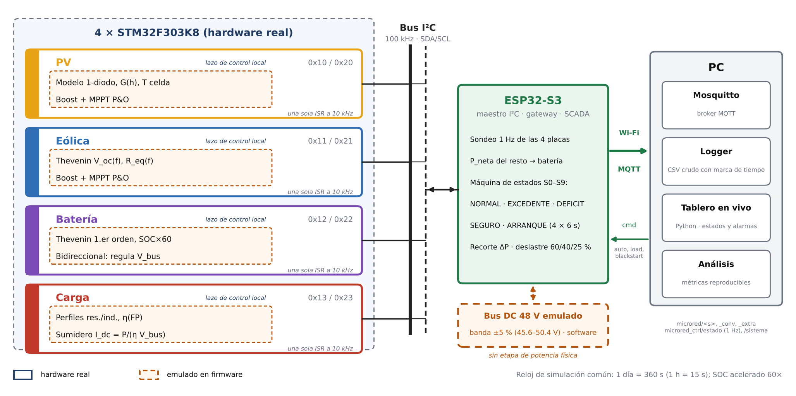

# VITA-DC: microrred DC de 48 V emulada

Sistema embebido que emula una microrred DC de 48 V con cuatro subsistemas (arreglo fotovoltaico, turbina eólica, banco de baterías y carga variable) y un SCADA. Proyecto de Taller de Potencia, Departamento de Ingeniería Eléctrica y Electrónica, Universidad de los Andes.

Cada subsistema corre en una **STM32F303K8** (modelo de la fuente, convertidor promediado y control local, todo en una interrupción de 10 kHz). Un **ESP32-S3** las lee por I2C a 100 kHz, ejecuta el SCADA (máquina de estados S0–S9) y publica por MQTT hacia un registrador y un tablero en el PC.



*Línea continua: hardware real. Línea punteada naranja: emulado en firmware. Versión por capas en [`docs/figuras/arquitectura_capas.png`](docs/figuras/arquitectura_capas.png).*

## Resultados principales

| Exp. | Resultado medido | Criterio |
|---|---|---|
| P0 | El PV arranca solo en 3 de 3 amaneceres (corrección del MPPT P&O) | 0 amaneceres atascados |
| E1 | Bus en banda 100 %; SOC mínimo 24.8 % | SOC mín. ≥ 20 % |
| E2/E3 | El SCADA reduce 71 % el tiempo con el bus sobre 53 V (52.5 → 15.2 %); pico de 57.91 V | reducción ≥ 30 %; tope 53 V **no cumplido** |
| E4 | Deslastre en ≤ 1 s tras cruzar el umbral; SOC mínimo 21.4 % | SOC mín. ≥ 20 % |
| E5 | Arranque en negro en 24.0 s; excursión de +12.1 % de día | excursión ±10 % **no cumplida de día** |
| E6 | PV desenergizado y detectado en ≈ 3 s; el bus se mantiene en 48.00 V | emulado, sin contactor |

Todos con el firmware v7 del gateway. Cada resultado es de una sola corrida (E3 tiene además una primera tanda en `datos/intentos_previos/`). Las limitaciones y el análisis están en el informe (`docs/informe/`).

## Mapa del repositorio

```
.
├── firmware/
│   ├── gateway_esp32/        ESP32-S3: SCADA + MQTT (gateway_v7) y variante con medición de latencia (gateway_v7_diag)
│   └── stm32_pv|eolica|bateria|carga/   una carpeta por placa (ver estado abajo)
├── scada_pc/                 registrador MQTT -> CSV, tablero SCADA (tkinter) y capa de alarmas (ISA-18.2)
├── datos/                    CSV crudos de cada experimento (P0, E1–E6) y línea base con el firmware anterior
├── analisis/                 métricas reproducibles, indicadores de alarmas y verificador de fase de E3
└── docs/
    ├── informe/              informe IEEE (main.tex) y anexos técnicos (anexos_tecnicos.tex)
    ├── protocolos/           protocolo experimental y guía de repetición de E3 y E4
    ├── normativas.md         alineación con ISA-18.2 (alarmas) e ISA-101 (HMI)
    ├── figuras/              figuras del informe y los scripts que las generan
    └── resultados_metricas.txt   salida de analisis/metricas_experimentos.py
```

Cada carpeta tiene su propio `README.md`.

## Cómo reproducir

**Solo analizar los datos (no requiere hardware):**

```bash
pip install -r requirements.txt
python analisis/metricas_experimentos.py          # imprime y guarda docs/resultados_metricas.txt
```

**Ver un experimento en el tablero sin hardware (replay):**

```bash
cd scada_pc
python scada_dashboard.py --replay ../datos/E4.csv --vel 10
```

**Montar el sistema:**

1. **STM32** (una por subsistema): compilar con `cmake --preset <preset>` y `cmake --build`, y cargar por SWD con `STM32_Programmer_CLI -c port=SWD -w <archivo>.elf -v -rst`. Energizar las cuatro placas **a la vez**, para que sus relojes de 360 s queden en fase.
2. **Gateway**: copiar `secrets.example.h` a `secrets.h` (red Wi-Fi e IP del broker) y cargar el sketch desde Arduino IDE.
3. **PC**: iniciar Mosquitto, luego `python scada_pc/logger_raw.py NOMBRE` (guarda todos los tópicos en un CSV) y, si se quiere, el tablero `python scada_pc/scada_dashboard.py`.

## Datos

Una fila por mensaje MQTT, con columnas `t_pc_iso, t_rel_s, topic, payload` (JSON). Detalle de cada experimento, fechas y tópicos en [`datos/README.md`](datos/README.md).

## Estado del firmware

| Carpeta | Contenido actual |
|---|---|
| `firmware/gateway_esp32/gateway_v7` | Sketch completo del gateway (SCADA y MQTT), el usado en los experimentos. |
| `firmware/gateway_esp32/gateway_v7_diag` | Igual, más medición de latencia I2C y MQTT (`microred_ctrl/diag`). Sin compilar todavía. |
| `firmware/stm32_pv`, `stm32_eolica`, `stm32_bateria`, `stm32_carga` | Proyecto CubeMX/CMake completo de cada placa (código propio, `.ioc`, scripts de CMake). Falta solo la HAL, que se regenera con CubeMX desde el `.ioc` (ver [`firmware/README.md`](firmware/README.md)). |

## Informe y protocolo

- Informe técnico: `docs/informe/main.tex`. Anexos técnicos (modelos, convertidor, bus I2C, lazos de control, reglas del SCADA): `docs/informe/anexos_tecnicos.tex`.
- Procedimiento y criterios de aceptación de cada experimento: `docs/protocolos/protocolo_experimentos.md`.

## Autores

Sofía Parra Rozo y Tomás Durán Cardoso. Departamento de Ingeniería Eléctrica y Electrónica, Universidad de los Andes.
